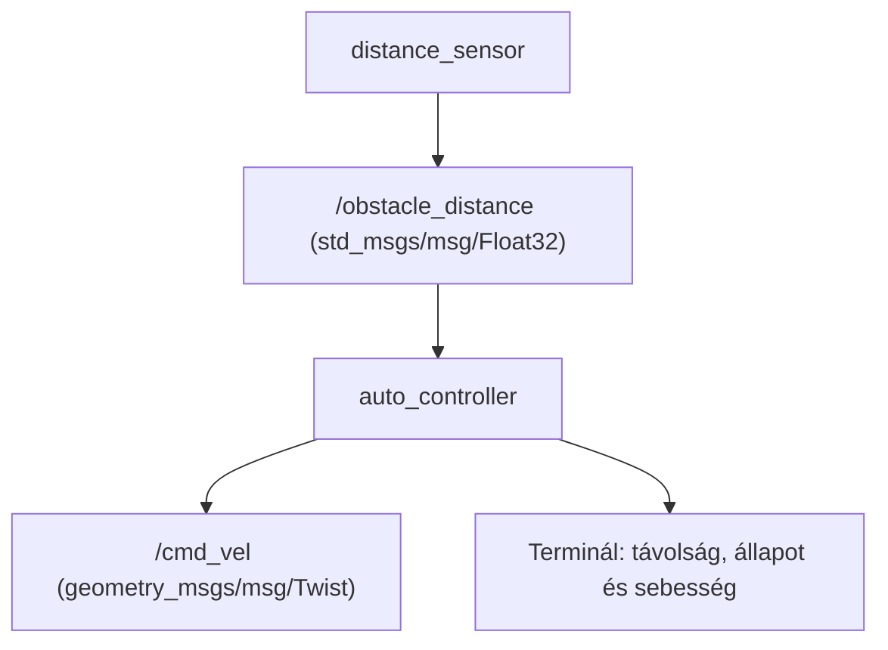

# vam_dl3_auto – Akadályérzékelés és sebességvezérlés

ROS 2 C++ kisbeadandó az Autonóm járművek és robotok programozása tárgyhoz.

Célkörnyezet: Ubuntu 22.04, ROS 2 Humble.

## A feladat leírása

A csomag egy autó egyszerű akadályérzékelését és sebességvezérlését
szemlélteti két ROS 2 node segítségével.

A `distance_sensor` node szimulált távolságadatokat publikál.
Az `auto_controller` node fogadja ezeket, és az akadály távolsága
alapján sebességparancsot állít elő.

A program nem tartalmaz grafikus járműszimulációt. Működése a
terminálban megjelenő üzenetekkel és a topicok tartalmával követhető.

## Működés

A távolságszenzor két másodpercenként küld egy értéket.
Az alábbi sorozat folyamatosan ismétlődik:

- 5 méter: normál haladás.
- 2 méter: lassítás.
- 0,5 méter: megállás.

A vezérlő az alábbi szabályokat alkalmazza:

| Akadály távolsága | Állapot | Sebesség |
|---|---|---|
| 0 ≤ távolság < 1 m | STOP – megállás | 0,0 m/s |
| 1 ≤ távolság < 3 m | SLOW – lassítás | 0,5 m/s |
| Távolság ≥ 3 m | DRIVE – haladás | 1,5 m/s |
| Érvénytelen adat: negatív, NaN vagy végtelen | INVALID INPUT – megállás | 0,0 m/s |

A sebességparancs a `geometry_msgs/msg/Twist` üzenet `linear.x`
mezőjében jelenik meg. A többi komponens értéke nulla.

A vezérlő minden beérkező távolságadatra egy sebességparancsot publikál.
Szenzorkimaradás esetére külön időzítés nincs megvalósítva.

## Node-ok és topicok

| Node | Feliratkozás | Publikálás |
|---|---|---|
| `/distance_sensor` | – | `/obstacle_distance` |
| `/auto_controller` | `/obstacle_distance` | `/cmd_vel` |

| Topic | Üzenettípus | Tartalom |
|---|---|---|
| `/obstacle_distance` | `std_msgs/msg/Float32` | Akadály távolsága méterben |
| `/cmd_vel` | `geometry_msgs/msg/Twist` | Sebességparancs |



## A csomag fájljai

- `src/distance_sensor.cpp`: szimulált távolságadatok előállítása és publikálása.
- `src/auto_controller.cpp`: távolságadatok fogadása és sebességparancs előállítása.
- `launch/auto.launch.py`: a két node együttes indítása.
- `CMakeLists.txt`: fordítási és telepítési beállítások.
- `package.xml`: csomagadatok és függőségek.

## Függőségek

A csomag fordításához és futtatásához ROS 2 Humble környezet,
C++ fordító és colcon szükséges.

A csomag ROS 2 függőségei:

- `ament_cmake`
- `rclcpp`
- `std_msgs`
- `geometry_msgs`
- `launch`
- `launch_ros`
- `ros2launch`

## Letöltés

A példában a munkaterület helye: `~/ros2_ws/`.

```bash
mkdir -p ~/ros2_ws/src
cd ~/ros2_ws/src
git clone https://github.com/Vamossz/vam_dl3_auto.git
```

Ha a repó már megtalálható a munkaterületen, nem szükséges újra klónozni.

## Fordítás

```bash
source /opt/ros/humble/setup.bash
cd ~/ros2_ws
colcon build --packages-select vam_dl3_auto --symlink-install
source ~/ros2_ws/install/setup.bash
```

## Indítás

A két node közös indítása:

```bash
ros2 launch vam_dl3_auto auto.launch.py
```

Leállítás: "Ctrl+C".

A node-ok külön terminálokban is elindíthatók:

```bash
ros2 run vam_dl3_auto distance_sensor
```

```bash
ros2 run vam_dl3_auto auto_controller
```

A külön indítást és a közös launch-ot ne használd egyszerre,
mert így a node-ok több példányban futnának.

Minden új terminálban, a ROS 2 parancsok előtt futtasul:

```bash
source /opt/ros/humble/setup.bash
source ~/ros2_ws/install/setup.bash
```

## A működés ellenőrzése

A program futása közben egy másik terminálban kilistázhatók a node-ok:

```bash
ros2 node list
```

A listában a következő node-oknak kell szerepelniük:

```text
/auto_controller
/distance_sensor
```

A topicok listázása:

```bash
ros2 topic list
```

A szimulált távolságadatok megfigyelése:

```bash
ros2 topic echo /obstacle_distance
```

A sebességparancsok megfigyelése külön terminálban,
vagy az előző echo parancs `Ctrl+C`-vel történő leállítása után:

```bash
ros2 topic echo /cmd_vel
```

A `linear.x` mezőben a távolságnak megfelelően az `1.5`, `0.5`
és `0.0` értékek ismétlődése várható.

A vezérlő termináljában az alábbi üzenetek várhatók
(a ROS 2 által hozzáadott előtagok és időbélyegek nélkül):

```text
Distance: 5.00 m | DRIVE | Speed: 1.50 m/s
Distance: 2.00 m | SLOW | Speed: 0.50 m/s
Distance: 0.50 m | STOP | Speed: 0.00 m/s
```

Ezek elvárt kimenetek; nem rögzített futási eredmények.

## Határértékek kézi ellenőrzése

Állítsd le a közös launch-ot, majd csak a vezérlőt indítsd el:

```bash
ros2 run vam_dl3_auto auto_controller
```

Egy másik, előkészített terminálban egyenként küldj tesztadatokat:

```bash
ros2 topic pub --once /obstacle_distance std_msgs/msg/Float32 '{data: 0.5}'
ros2 topic pub --once /obstacle_distance std_msgs/msg/Float32 '{data: 1.0}'
ros2 topic pub --once /obstacle_distance std_msgs/msg/Float32 '{data: 3.0}'
ros2 topic pub --once /obstacle_distance std_msgs/msg/Float32 '{data: -1.0}'
```

Az eredmények a vezérlő termináljában ellenőrizhetők:

| Bemenet | Elvárt állapot | Elvárt sebesség |
|---|---|---|
| 0,5 m | STOP | 0,0 m/s |
| 1,0 m | SLOW | 0,5 m/s |
| 3,0 m | DRIVE | 1,5 m/s |
| −1,0 m | INVALID INPUT - STOP | 0,0 m/s |

## Források

- [A kisbeadandó követelményei](https://sze-info.github.io/ajr/feleves_beadando/kisbeadando/)
- [Kiinduló ROS 2 C++ sablon](https://github.com/sze-info/ros2_cpp_template)
- [Oktatói példa adatgenerálásra és vezérlésre](https://github.com/umiklos/ung_isl_ajr_data_generation_and_control)

## Licenc

A projekt a kiinduló sablon GNU GPL v3.0 licencét használja.
A licenc teljes szövege a `LICENSE` fájlban található.